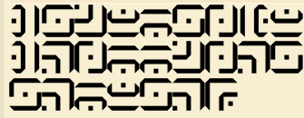
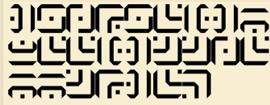
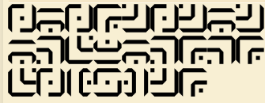
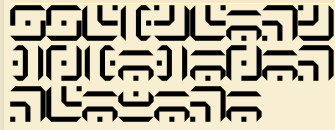
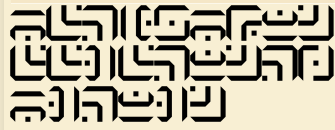

# Tomb Translation – full writeup

[← Back to Cryptography](../README.md) · [Challenge overview](README.md)

**Category:** Cryptography (encoding) · **Points:** 100 · **Flag:** `SecLeaf{l1nk_1s_st1ll_l00k1ng_f0r_z3ld4}`

**Author:** [Rutwik](https://github.com/Rutwik-712) · **Team:** Bug Busters

## TL;DR

1. The five panels are written in Sheikah (the script from *The Legend of Zelda*), using only its numeral symbols.
2. Reading each panel left-to-right, top-to-bottom, in the given order, gives 124 decimal digits.
3. As one integer in base 36 it becomes 80 characters that happen to be all hex digits.
4. Hex-decoding those gives 40 ASCII bytes: the flag. Reversing every step reproduces the input exactly.

## The challenge

> "Something was written on the walls of an old tomb." "You just need to figure out what it says."

We were given five images of angular, maze-like symbols with dots:

| Panel | Image |
| --- | --- |
| 1 |  |
| 2 |  |
| 3 |  |
| 4 |  |
| 5 |  |

"Tomb" plus this look points at Sheikah, the script carved into shrines in Zelda. "Translation" suggests a substitution, but as it turned out the translation is only the first layer: it produces digits, not words.

## Step 1 – Translate the glyphs into digits

Repeated shapes meant a symbol substitution. Comparing them with the dCode Sheikah chart showed that every glyph was one of Sheikah's ten **numeral** symbols. We matched each glyph against the chart rather than hoping for readable English.

Reading each panel left-to-right and then down to the next line:

| Panel | Digits | Count |
| ---: | --- | ---: |
| 1 | `4512850624708810755782579` | 25 |
| 2 | `4509536482336411038819437` | 25 |
| 3 | `0809101818732879793065419` | 25 |
| 4 | `5536138714068480877382878` | 25 |
| 5 | `837658921334372170847241` | 24 |

Panel 3 starts with `0`. If you converted each panel to an integer separately, that zero would disappear; it has to stay because it is a digit of one big number.

## Step 2 – Join the panels into one number

We concatenated the five strings in panel order, with no separators:

```text
4512850624708810755782579 4509536482336411038819437 0809101818732879793065419 5536138714068480877382878 837658921334372170847241
```

(spaces shown only for readability). The result is a single 124-digit integer. This is far beyond float precision, so it needs big-integer arithmetic: Node.js `BigInt`, Python `int`, or CyberChef.

## Step 3 – Write the number in base 36

Why base 36? A giant decimal number is the classic disguise for "bytes read as one integer". Rewriting it in another base and looking for structure is cheap. In base 36 we got:

```text
5365634c6561667b6c316e6b5f31735f7374316c6c5f6c30306b316e675f6630725f7a336c64347d
```

Base 36 may use `0–9` and `a–z`, yet this output uses only `0–9a–f`, and it has an even length (80). Random base-36 text would almost never avoid `g–z` across 80 characters. That is a hex string. Its first bytes, `53 65 63 4c 65 61 66 7b`, are `SecLeaf{`.

CyberChef recipe:

| Setting | Value |
| --- | --- |
| Input | all 124 digits as one number |
| Operation 1 | To Base, radix 36 |
| Operation 2 | From Hex, delimiter None |

## Step 4 – Decode the hex

Each pair of characters is one byte (`53` = `S`, `65` = `e`, `63` = `c`, `4c` = `L`, …):

```bash
xxd -r -p message.hex
SecLeaf{l1nk_1s_st1ll_l00k1ng_f0r_z3ld4}
```

80 hex characters → 40 ASCII bytes. "Link is still looking for Zelda" fits the Sheikah theme.

## Flag

```text
SecLeaf{l1nk_1s_st1ll_l00k1ng_f0r_z3ld4}
```

## Why this is the right answer

Every step was checked in reverse:

| Layer | Check |
| --- | --- |
| Transcription | 25 + 25 + 25 + 25 + 24 = 124 digits |
| Decimal → base 36 | 80 hex-only characters; converting back restores the full 124-digit input |
| Hex → text | 40 ASCII bytes; re-encoding gives the same 80-character hex string |
| Format | starts with `SecLeaf{`, ends with `}` |

A single misread glyph would change the number, and almost certainly push letters `g–z` into the base-36 output or garble the hex. Getting clean, readable ASCII with the right prefix is strong evidence that all 124 glyphs were read correctly and in the right order.

## What we learned

- **Translation can be an intermediate step.** The script gave digits, not the message.
- **Order and leading zeros matter.** Panel order and panel 3's leading `0` are part of the number.
- **Big numbers need big integers.** A float would silently destroy a 124-digit value.
- **Look for a restricted alphabet.** Base-36 output that only uses `0–9a–f` is a giveaway for hex; a known prefix like `SecLeaf{` confirms it.

## Reproduce

```bash
cd solve
python3 solve.py
```

The solver embeds our transcribed digits and does decimal → base 36 → hex → ASCII with the inverse checks. Full solver: [`solve/solve.py`](solve/solve.py)

## References

- dCode, Sheikah language chart and translator
- CyberChef, To Base and From Hex operations

---

[← Back to Cryptography](../README.md) · [Challenge overview](README.md)
